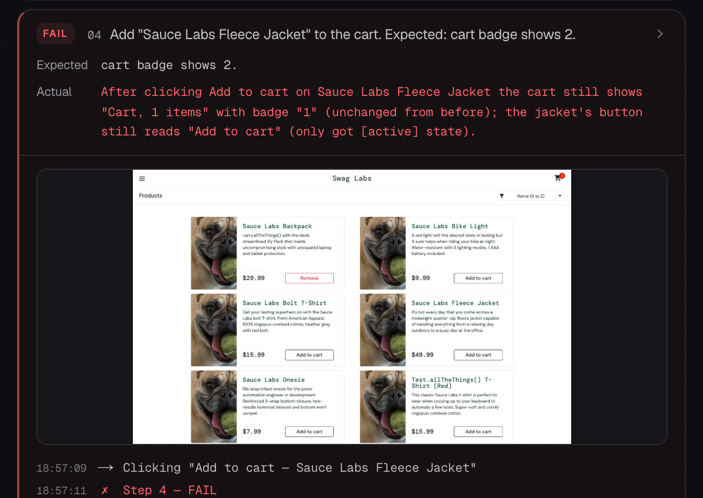

<h1 align="center">qpilot</h1>

<p align="center">
  <b>Paste a manual test case. An AI agent runs it in real Chrome<br>and tells you which step broke — with proof.</b>
</p>

<p align="center">
  <a href="https://www.npmjs.com/package/qpilot"></a>
  <a href="https://github.com/broxhq/qpilot/actions/workflows/ci.yml"></a>
  
  
  <a href="https://github.com/broxhq/qpilot"></a>
</p>

<p align="center">
  
</p>

<p align="center">
  <sub>A real run, not a mock-up: 17 seconds against <a href="https://www.saucedemo.com">saucedemo.com</a> with its deliberately buggy <code>problem_user</code>. The middle of the recording is sped up 1.5×.</sub>
</p>

```bash
npx qpilot
```

That's the whole install. No test code, no selectors, no config files.

**Needs:** Node.js 20.12+, Google Chrome, and an [Anthropic API key](https://console.anthropic.com)
— or any OpenAI-compatible endpoint (Qwen, vLLM, Ollama, a corporate gateway).

## What you get back

Not "the test failed", but which step, what was expected, what the page actually
showed, and a screenshot of that moment:

<p align="center">
  
</p>

Every step ends as `pass`, `fail` or `warn`. When the run is over, **Copy report**
gives you Markdown for the ticket and **Download report** one HTML file with the
screenshots inside.

## Why you can trust a green step

Getting an agent to click through a page is the easy part. The hard part is a
`pass` you don't have to re-check yourself. That is what most of qpilot is about:

- **The expected result comes from your test case.** The report puts it next to what
  the page actually showed, so a lowered bar is visible at a glance.
- **Every pass is checked a second time.** A separate model call with a clean context
  gets the step, the agent's claim and what the browser actually returned. It can
  only object: the step then becomes a `warn` with the reason and a screenshot, for
  you to decide.
- **Sizes and colours are measured, not eyeballed.** From a screenshot a model
  called a 46 px overlap of two buttons "no overlap". So position, size, overlap and
  colour are read from the browser, in pixels and RGB.
- **A broken page fails the run.** The agent does not retry its way around a bug or
  try other paths until something passes.

How well the second check works so far, on one model and a small set: on 45 correct
passes it raised no false objections; of 13 passes whose recorded facts were
deliberately altered it flagged 12.

## How it works

1. Paste a plain-text test case — the messy kind a PM writes in Confluence is fine.
2. The agent opens Chrome and executes each step. It reads the page as an
   accessibility tree on every action, so nothing is stored that can go stale after
   a redesign.
3. Results stream in live, step by step.
4. Hits an OTP or a captcha? It pauses and asks you, then carries on.

If the model can see images, the agent also looks at the page when text is not
enough: an icon with no label, a picture, a chart, a canvas. Nothing to switch on —
at the start of a run the agent checks whether the model reads a picture, and with a
text-only model it works without screenshots.

| | Manual testing | Scripted e2e | **qpilot** |
|---|---|---|---|
| To add a test | write the steps | write and maintain code | write the steps |
| Who can write it | anyone | someone who codes | anyone |
| After a redesign | a human adapts | update the test code | nothing to update |
| OTP / captcha | handled by the human | usually blocks the run | pauses and asks you |
| Output | you watched it | pass/fail | pass/fail/warn per step + evidence |

<details>
<summary><b>And next to other AI agents</b></summary>

<br>

- **Browser agents for developers** (Playwright MCP, browser-use and the like) give
  an AI assistant a browser to drive from an IDE or a chat. qpilot is for the person
  who owns the test cases: paste the case, get a verdict per step with evidence, a
  screenshot of every failure and a report to attach to the ticket. No IDE, no
  prompt writing.
- **Device agents** such as Google's Artemis automate Android phones. qpilot tests
  web apps in desktop Chrome.
- **What is specific to testing here:** request mocks and a request log, a second
  check of every passed step, measured sizes and colours instead of "looks fine",
  OTP and captcha handed to a human mid-run.

</details>

## Writing a test case

This is the case from the recording above, as it was pasted:

```
TC-014 — Add two items to the cart
URL: https://www.saucedemo.com/
Credentials: problem_user / secret_sauce

1. Open the page.
   Expected: login form with Username and Password.
2. Log in.
   Expected: Products page with 6 items.
3. Add "Sauce Labs Backpack" to the cart.
   Expected: cart badge shows 1.
4. Add "Sauce Labs Fleece Jacket" to the cart.
   Expected: cart badge shows 2.
5. Open the cart.
   Expected: both items are listed.
```

No format is required — headings, numbering and "Expected:" lines are all optional.
The clearer the expected result, the stricter the check. Paste several test cases
at once and the agent runs them in order, grouped in the UI.

More examples and tips: [docs/test-case-format.md](docs/test-case-format.md).

## What else it can do

<details>
<summary><b>Mock and inspect requests</b> — what you would do with Charles or the Network tab, as one line of the case</summary>

<br>

```
3. Replace the response of GET /api/cart with an empty list and open the cart.
   Expected: the "Your cart is empty" placeholder is shown.
4. Make POST /api/orders return 500 and click "Place order".
   Expected: an error message is shown.
5. Place the order for real.
   Expected: POST /api/orders was sent with amount=3980 and returned 201.
```

The agent can answer a request with made-up data (it invents a realistic body when
you give none), patch one field of the real response, fail or delay a request, go
offline, and read back what the page actually sent and received. JavaScript console
errors are noted on the step where they happened.

Tokens, passwords and cookies in request and response bodies are masked before the
model or the report sees them.

</details>

<details>
<summary><b>Upload files</b> — an avatar, a CSV to import, a PDF to attach</summary>

<br>

Click **Attach files** before running, and the agent can hand them to any upload
control on the page — including the hidden `<input type=file>` behind a styled
"Choose file" button.

Files live only for the duration of the run and are deleted when it ends. The agent
can upload them, but never sees what is inside them.

</details>

<details>
<summary><b>Tabs, dialogs and passwords</b></summary>

<br>

- A link that opens a new tab moves the agent to that tab; it can switch back.
- Native `alert` / `confirm` / `prompt` dialogs are accepted by default. Write "press
  Cancel" in the step and the agent dismisses the dialog instead.
- Whatever is typed into a password field is masked in the log and the report.

</details>

<details>
<summary><b>Run a folder of test cases</b></summary>

<br>

**Choose folder** points qpilot at a directory of `.md` files. Tick the ones you
want and run them as a batch — one after another, with live status and timing, and
a **Stop** button. Finished runs land under **Recent runs**.

</details>

<details>
<summary><b>Rerun and edit</b></summary>

<br>

When a run ends you can **Run again**, or **Edit test case** and rerun. Browser
visibility is per run: **Run** stays headless, **Run with preview** lets you watch
Chrome work.

</details>

## Models

Open **Settings** (top right of the home page) to pick the provider, paste the API
key and type the model id. Changes apply to the next run — no restart. On first
launch qpilot opens Settings by itself; `npx qpilot config` opens the same page
directly.

- **Anthropic (Claude)** — paste your `sk-ant-…` key. Defaults to `claude-haiku-4-5`.
  A base URL is optional, for reaching Claude through a corporate proxy.
- **Custom** — any OpenAI-compatible endpoint. Give it a base URL, token and model id:

  ```
  Base URL: https://dashscope-intl.aliyuncs.com/compatible-mode/v1
  Model id: qwen2.5-72b-instruct
  ```

  The model must support tool calling — that is how the agent drives the browser.

Your choice is saved to `~/.qpilot/config.json` (mode `600`). For the Anthropic
provider you can skip setup entirely with an `ANTHROPIC_API_KEY` env var or a
`.env.local` file.

## Good to know

- **Everything runs locally.** Nothing leaves your machine except the model calls, so
  qpilot works against staging and internal networks.
- **Speed is the model's speed:** a run is mostly waiting for its answers. The run
  page shows the split (model / browser / number of calls). A model that writes
  output fast and supports tool calling makes runs several times shorter.
- The local API only answers qpilot's own pages: requests from other websites
  are refused, and so are host names other than `localhost` / `127.0.0.1`.
  Serving qpilot under another name (e.g. behind a reverse proxy)? List it in
  `QPILOT_ALLOWED_HOSTS`.
- Runs are held in memory, last 50 only — restarting the server clears them.
- Light and dark themes: follows your system by default, or pick one in **Settings**.

## Contributing

Issues and pull requests are welcome — see [CONTRIBUTING.md](CONTRIBUTING.md).
Questions go to [Discussions](https://github.com/broxhq/qpilot/discussions); for a
security problem see [SECURITY.md](SECURITY.md).

---

<p align="center">
  Built with <a href="https://www.anthropic.com">Claude</a> and <a href="https://playwright.dev">Playwright</a>.<br>
  If qpilot saved you time, a <a href="https://github.com/broxhq/qpilot">⭐ on GitHub</a> helps more than you'd think.
</p>
